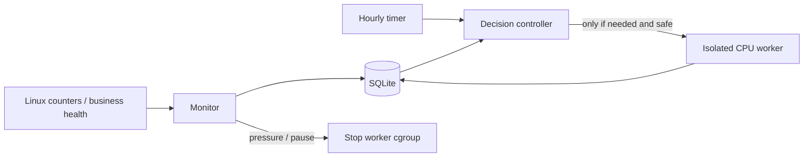

# 决策依据

- [Oracle Always Free](https://docs.oracle.com/en-us/iaas/Content/FreeTier/freetier_topic-Always_Free_Resources.htm)：过去七天 CPU 的 P95、网络及 A1 内存利用率同时低于相应 20% 条件时，空闲实例可能被回收。该说明没有承诺压力任务能免除所有回收原因。
- [参考文章](https://laomingong.com/2026-oracle-cloud-anti-reclaim) 的 systemd/低优先级思路可用；其配套仓库独立 service 与一键安装脚本有 2,400/7,200 秒差异。本项目统一参数，计入实际 CPU 达标样本。
- [stress-ng 手册](https://github.com/ColinIanKing/stress-ng/blob/master/stress-ng.1)：本项目只使用 CPU worker，内存压力不是活跃度的默认策略。
- [systemd 资源控制](https://www.freedesktop.org/software/systemd/man/latest/systemd.resource-control.html)：CPUQuota 以单核为基准，必须随总核数换算。
- [OCI Compute Metrics](https://docs.oracle.com/en-us/iaas/Content/Compute/References/computemetrics.htm) 与 [MQL](https://docs.oracle.com/en-us/iaas/Content/Monitoring/Reference/mql.htm)：云端查询使用 `CpuUtilization[1m]{resourceId="<实例OCID>"}.mean()` 的序列计算全窗口 P95，不能把每分钟 P95 的均值当作七天 P95。

每日 144 分钟约为全天 10%，比恰好 5% 留出采样与争用余量；整机 30% 的计算任务在全天折合约 3% 的额外 CPU。自然业务达到目标时额外开销更低。低优先级与 35% 硬上限同时存在，负载不能因配置或重试无限放大。

真实业务先计入，采样缺口保持缺口。独立 SQLite 保存执行预算和暂停状态；控制器退出、worker 超时、进程被杀和断电后的不确定运行时间按有界上限保守记账，但不当成有效 CPU 分钟。

监测器与控制器分开，worker 动态创建：

新部署先观察 24 小时再自动按需补足，手动校准受相同安全和预算边界约束。当前版本不持有云账户密钥、不自动查询账单，也不建立外部通知订阅。账户级权益、云端监控、异机备份仍需独立核验。
